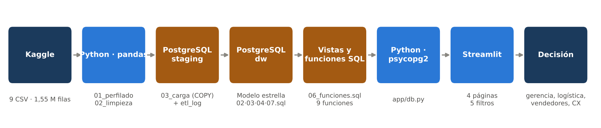
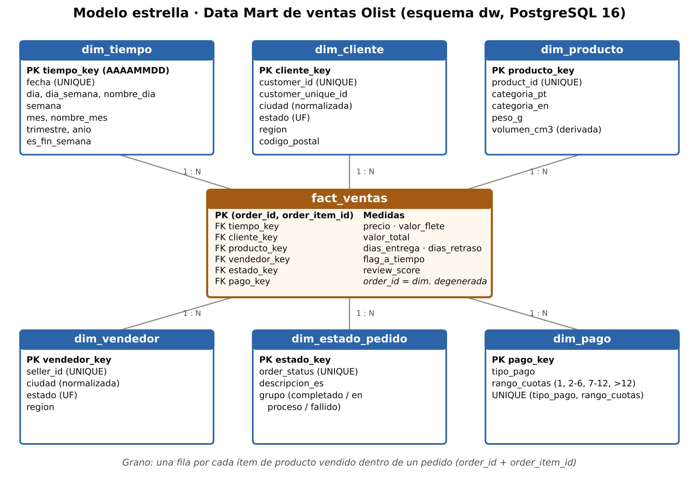

# Olist BI · Ventas, entregas y satisfacción del cliente (2017–2018)

Solución de Business Intelligence de extremo a extremo sobre el
[Brazilian E-Commerce Public Dataset by Olist](https://www.kaggle.com/datasets/olistbr/brazilian-ecommerce):
perfilamiento y limpieza con **Python/pandas**, Data Mart dimensional en **PostgreSQL 16**,
capa analítica con **vistas y funciones SQL**, y dashboard interactivo en **Streamlit**.

> Universidad Estatal Península de Santa Elena · Inteligencia de Negocios · 6/1
> Entregable 3 · Mi primer dashboard · María de los Ángeles Llerena Hernández

```
Kaggle (9 CSV) → pandas (perfilado + limpieza) → PostgreSQL staging → modelo estrella dw
→ vistas / funciones SQL → Python (psycopg2) → Streamlit → decisión
```



## Estructura del repositorio

```
├── app/                         Aplicación Streamlit (solo lee PostgreSQL)
│   ├── Inicio.py                Página 1 · Resumen ejecutivo
│   ├── pages/1_Ventas.py        Página 2 · Ventas por categoría, estado y medio de pago
│   ├── pages/2_Logistica_y_Satisfaccion.py   Página 3 · Puntualidad y reseñas
│   ├── pages/3_Vendedores.py    Página 4 · Ranking de vendedores (tabla de detalle)
│   ├── componentes.py           Filtros compartidos, tarjetas, formatos, estilo de gráficos
│   └── db.py                    Conexión a PostgreSQL y llamadas a las funciones dw.fn_*
├── etl/
│   ├── config.py                Rutas y parámetros de conexión (.env)
│   ├── 01_perfilado.py          Perfilamiento de los 9 CSV → reports/perfilado.md
│   ├── 02_limpieza.py           Limpieza con pandas → data/clean/*.csv + bitácora
│   ├── 03_carga.py              COPY a staging, construcción del DW y validaciones
│   └── run_pipeline.py          Ejecuta los tres pasos en orden
├── sql/
│   ├── 01_staging.sql           Esquema staging (datos limpios) + etl_log
│   ├── 02_dw_tablas.sql         Modelo estrella: 6 dimensiones + fact_ventas, PK/FK, índices
│   ├── 03_dimensiones.sql       Carga de dimensiones (dim_tiempo generada 2017–2018)
│   ├── 04_fact_ventas.sql       Carga de la tabla de hechos (grano: ítem de pedido)
│   ├── 05_validaciones.sql      Consultas de validación (registros, integridad, nulos, totales)
│   ├── 06_funciones.sql         Vista base + 9 funciones de consumo analítico
│   └── 07_restricciones.sql     Restricciones CHECK de calidad
├── docs/
│   ├── Entregable3_Informe_Final.docx   Documento final del proyecto (Word)
│   ├── matriz_trazabilidad.md
│   ├── uso_ia.md                Evidencias de uso de Inteligencia Artificial
│   ├── guion_video.md           Guion del video de 3–5 minutos
│   └── img/                     Diagrama estrella, mockup, arquitectura y gráficos
├── reports/                     Salidas del ETL: perfilado, bitácora y validaciones
├── data/README.md               Cómo descargar el dataset (los CSV no se versionan)
├── docker-compose.yml           PostgreSQL 16 + Adminer
├── requirements.txt
└── .env.example
```

## Requisitos

- Python 3.11 – 3.13
- Docker Desktop (o un PostgreSQL 16 local)
- El dataset de Kaggle descomprimido en `data/raw/` (ver [data/README.md](data/README.md))

## Ejecución paso a paso

**1. Clonar el repositorio e instalar dependencias**

```bash
git clone https://github.com/MariaLlerenaHernandez/Brazilian-E-Commerce-Public-Dataset-by-Olist.git
cd Brazilian-E-Commerce-Public-Dataset-by-Olist
python -m venv .venv
# Windows: .venv\Scripts\activate     Linux/macOS: source .venv/bin/activate
pip install -r requirements.txt
copy .env.example .env               # Linux/macOS: cp .env.example .env
```

**2. Levantar PostgreSQL**

```bash
docker compose up -d
```

Adminer queda disponible en <http://localhost:8080> (Sistema: PostgreSQL · Servidor: `postgres` ·
Usuario: `bi_user` · Contraseña: `bi_pass` · Base: `bi_database`).

**3. Ejecutar el ETL completo** (perfilado → limpieza → carga → validaciones, ≈ 1–2 min)

```bash
python etl/run_pipeline.py
```

Los pasos también pueden ejecutarse por separado: `python etl/01_perfilado.py`,
`python etl/02_limpieza.py`, `python etl/03_carga.py`. La carga se ejecuta en una sola
transacción: si algo falla, la base queda como estaba.

**4. Revisar las validaciones**

El resultado queda en `reports/validaciones.md`. También pueden ejecutarse directamente:

```powershell
# Windows PowerShell
Get-Content .\sql\05_validaciones.sql -Raw | docker exec -i bi-postgres psql -U bi_user -d bi_database
```

```bash
# Linux / macOS
docker exec -i bi-postgres psql -U bi_user -d bi_database < sql/05_validaciones.sql
```

**5. Iniciar el dashboard**

```bash
streamlit run app/Inicio.py
```

Se abre en <http://localhost:8501>.

## Modelo dimensional



**Granularidad:** una fila de `dw.fact_ventas` representa **un ítem de producto vendido dentro
de un pedido** (`order_id` + `order_item_id`), comprado entre el 01/01/2017 y el 31/08/2018.

## Funciones SQL que consume la aplicación

Todas reciben los mismos filtros (`p_fecha_ini`, `p_fecha_fin`, `p_region`, `p_categoria`,
`p_estado`, `p_tipo_pago`; `NULL` = todos) y se apoyan en `dw.fn_ventas_filtradas`.

| Función | Uso en el dashboard |
|---|---|
| `dw.fn_kpis` | Tarjetas KPI |
| `dw.fn_ingresos_mensuales` | Gráfico de líneas de ingresos por mes |
| `dw.fn_ventas_por_categoria` | Barras de ingresos por categoría |
| `dw.fn_ventas_por_estado` | Barras por estado + tabla de detalle por estado |
| `dw.fn_csat_por_puntualidad` | Barras de CSAT a tiempo vs. con retraso |
| `dw.fn_csat_por_retraso` | Barras de CSAT por tramo de días de retraso |
| `dw.fn_medios_pago` | Medios de pago y ticket por cuotas |
| `dw.fn_ranking_vendedores` | Tabla de detalle de vendedores |

Ejemplo:

```sql
SELECT * FROM dw.fn_kpis(p_region => 'Nordeste', p_tipo_pago => 'boleto');
SELECT * FROM dw.fn_ranking_vendedores(p_limite => 10, p_orden => 'retraso', p_min_pedidos => 30);
```

## Restricción cumplida

La aplicación **no lee ningún CSV**: todos los KPI, gráficos y tablas provienen de PostgreSQL a
través de `app/db.py`, que solo puede invocar las funciones de una lista blanca. Cada gráfico
incluye el expansor **“Ver consulta SQL”** con la llamada exacta y los valores de los filtros.

## Solución de problemas

| Síntoma | Causa / solución |
|---|---|
| `could not connect to server` | El contenedor no está activo: `docker compose up -d` y revisar `.env`. |
| `FileNotFoundError ... data/raw/...` | Falta descargar el dataset de Kaggle en `data/raw/`. |
| `relation "dw.fact_ventas" does not exist` | Ejecutar primero `python etl/run_pipeline.py`. |
| Puerto 5432 ocupado | Cambiar el puerto en `docker-compose.yml` y `DB_PORT` en `.env`. |
